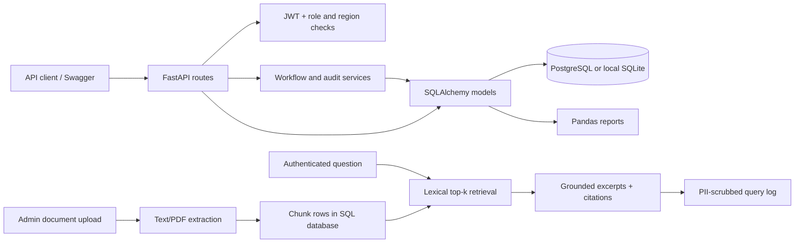

# ClaimsIQ backend architecture

## Request boundaries

- Endpoints authenticate and validate input, then call workflow logic or query models.
- `api/deps.py` enforces user identity and role checks. Claim/policy handlers additionally scope results by region/assignment.
- `claim_workflow.py` owns policy eligibility, assignment validation, allowed status transitions, manager overrides, high-value approval, history, and notes. Manager assignment changes are audited.
- `audit_service.py` appends canonical SHA-256 chained rows. The Admin verification endpoint checks the stored chain.
- Document ingestion accepts text/Markdown or text-extractable PDFs, chunks at configured character limits with overlap, and persists source/page metadata.
- Retrieval queries only active document/chunk rows, ranks question terms, returns bounded source excerpts, and records a redacted query log. No external model is called, so answers cannot add unsupported facts.
- Analytics loads filtered claims/query log rows into Pandas for duplicate/missing-value handling, KPIs, trends, workload, and SLA calculations.

## Deployment notes

The Docker Compose deployment contains the API and PostgreSQL. Uploaded files use a persistent named volume. Alembic applies the schema before API startup. The local SQLite setup uses the same models and migration for a one-developer workflow.
