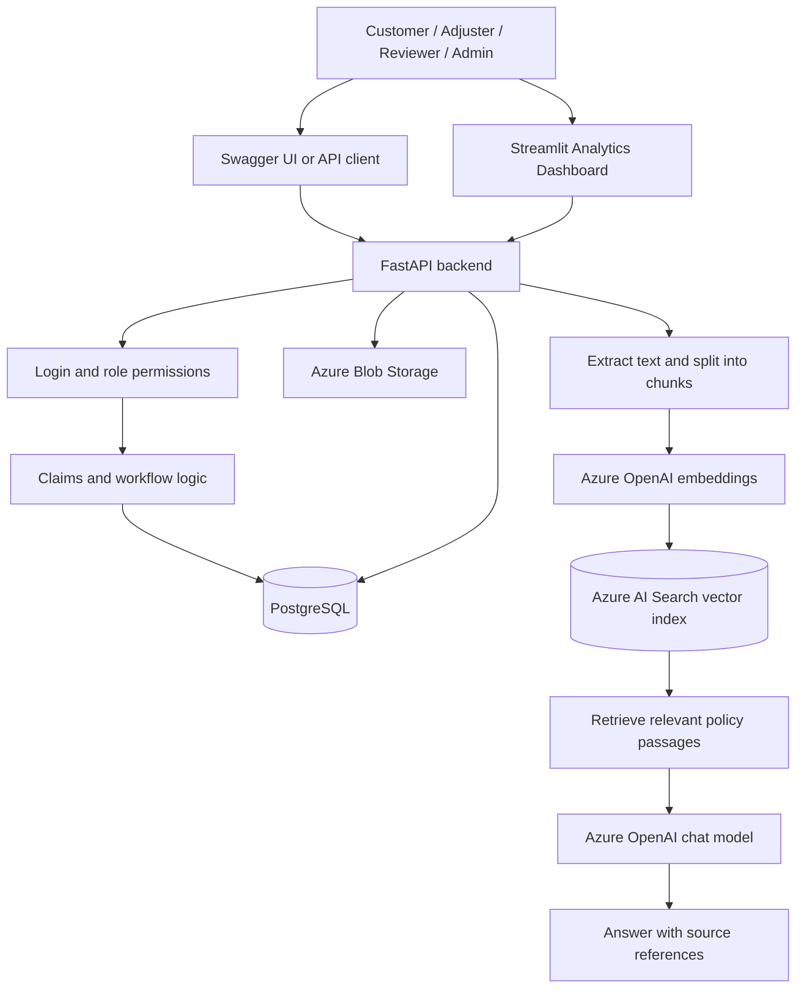
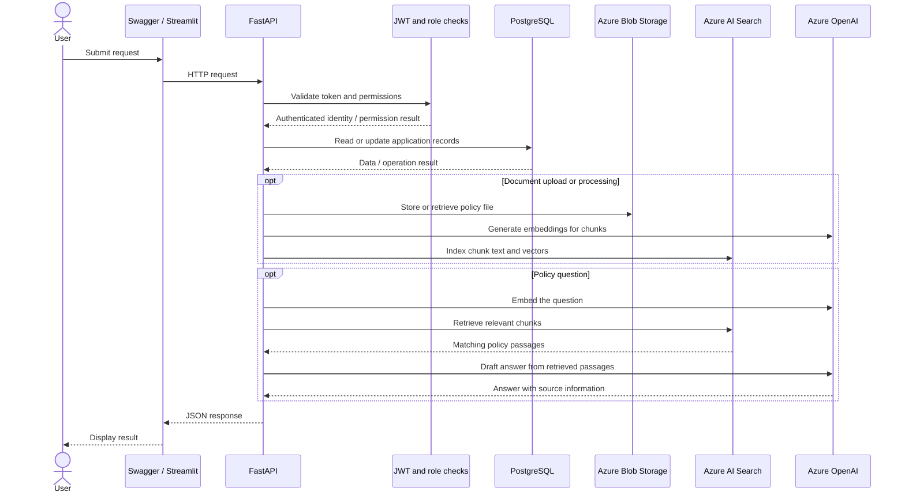
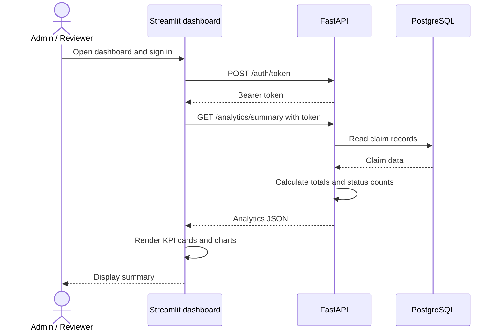
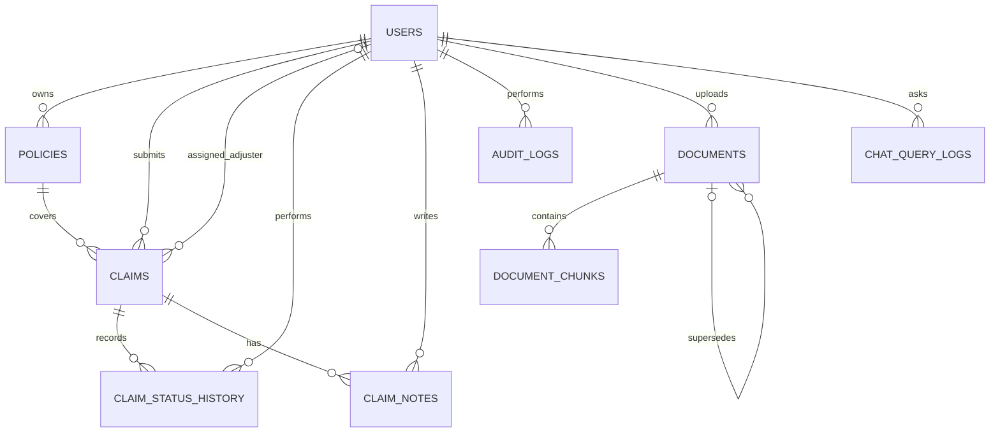

# ClaimIQ Architecture Guide


This guide explains what the current ClaimIQ code does, in plain language. You do not need programming experience to follow the main sections.


## 1. What is ClaimIQ?


ClaimIQ is a demonstration application with two related capabilities:


1. ****Claims Management**** — customers submit insurance claims; claims can be assigned to adjusters, reviewed, commented on, and moved through a controlled status workflow.

2. ****Policy Document Q&A (RAG)**** — an authorized user uploads a policy document, the system processes its text, and a user can ask a question about the processed policy. The answer is generated using relevant passages from the policy and includes source references.


It also provides an analytics API and a Streamlit dashboard.


> ****Important:**** RAG is included in this codebase. It is not just a keyword search. The document workflow extracts text, splits it into chunks, creates embeddings, stores searchable vectors in Azure AI Search, retrieves relevant passages, and sends those passages to the configured Azure OpenAI chat deployment to draft an answer. The response includes source information. The answer is assistance for a human reviewer, not an automatic claim decision.


## 2. Simple overview

## Technology stack

| Technology / service | Purpose in ClaimIQ |
|---|---|
| Python | Main application language |
| FastAPI | Exposes REST API endpoints and enforces application rules |
| Uvicorn | Runs the FastAPI application |
| PostgreSQL | Stores user, policy, claim, document, chunk, audit, and query-log records |
| SQLAlchemy | Maps Python models to PostgreSQL tables |
| Pydantic | Validates request and response data |
| JWT bearer token | Identifies the authenticated user on protected requests |
| Streamlit | Provides the analytics dashboard |
| Azure Blob Storage | Stores uploaded policy documents |
| Azure OpenAI embeddings deployment | Converts document chunks and questions into vectors |
| Azure AI Search | Retrieves relevant indexed policy chunks using vector search |
| Azure OpenAI chat deployment | Drafts an answer grounded in retrieved policy passages |
| PyPDF / document extraction service | Extracts text from supported PDF and DOCX documents |
| Docker / Docker Compose | Supports local container-based development when configured |
| pytest | Runs automated tests configured for the project |





### Request and response sequence



### What each part means


| Part | In simple words |
|---|---|
| FastAPI | The backend that receives requests and applies the application's rules. |
| Swagger UI (`/docs`) | A web page for trying the API endpoints manually. |
| PostgreSQL | The database that stores users, policies, claims, notes, status history, document records, and query logs. |
| JWT token | A temporary login credential sent with protected API requests. |
| Azure Blob Storage | Stores uploaded policy files. |
| Text extraction | Reads text from a supported PDF or DOCX file. Scanned PDFs may need OCR, which this project does not provide. |
| Chunking | Splits extracted text into smaller passages so relevant sections can be found. |
| Embeddings | Converts text into numeric vectors that represent meaning. |
| Azure AI Search | Finds relevant passages from the indexed policy chunks. |
| Azure OpenAI chat deployment | Writes a response using the retrieved policy passages and the RAG prompt. |
| Streamlit dashboard | Shows claim totals, assigned/unassigned claims, amounts, and status charts by calling the analytics API. |


## 3. Claims Management


### Typical claim flow


1. A user signs in and receives a token.

2. A customer submits a claim against an active policy that belongs to that customer.

3. The system automatically assigns the new claim to an active adjuster with the fewest open claims.

4. An authorized user reviews the claim and changes its status according to the allowed workflow.

5. Status changes are recorded in claim status history. Notes are saved separately from the claim description.

6. Admins and reviewers can view the analytics summary. Admins can inspect audit records.


### Allowed claim statuses


The status values used by the code are lowercase:


`submitted` → `under_review` → (`approved` or `denied`) → `closed`


The API enforces the transition rules. An invalid transition can only be overridden by an admin, and an admin override requires a justification. Adjusters can move a claim to `under_review`, but cannot approve or deny it.


### Roles at a glance


| Role | Main capabilities in the current code |
|---|---|
| `customer` | View own policies and claims; submit a claim against their own active policy. |
| `adjuster` | View claims assigned to them; add notes; move assigned claims to review; ask policy questions. |
| `reviewer` | Review and assign claims, make approval/denial decisions, add notes, view analytics, and ask policy questions. |
| `admin` | Administer users/policies, assign claims, override invalid status transitions with justification, view audit logs and analytics, manage policy documents, and ask policy questions. |
| `support_agent` | View claims/documents permitted by the API and ask policy questions; does not receive claim mutation permissions by default. |


Every endpoint has its own permission checks. Use Swagger to confirm the response for a particular role.

### Role and permission overview

| Capability | Customer | Adjuster | Reviewer | Admin | Support agent |
|---|---:|---:|---:|---:|---:|
| Sign in and view own profile | Yes | Yes | Yes | Yes | Yes |
| View own claims / assigned claims | Own claims | Assigned claims | According to reviewer permissions | According to admin permissions | According to endpoint permissions |
| Submit a claim | Yes, against own active policy | No by default | No by default | Depends on route rules | No by default |
| Assign an adjuster | No | No | Yes | Yes | No |
| Change claim status | No | Review-stage permissions only | Review/decision permissions | Administrative permissions | No by default |
| Add claim notes | No by default | Yes, for permitted claims | Yes | Yes | No by default |
| Manage policy documents | No | Limited by route permissions | Route-dependent | Yes | No by default |
| Ask policy questions | Subject to endpoint permissions | Yes | Yes | Yes | Yes, subject to endpoint permissions |
| View analytics | No | No | Yes | Yes | No |
| View audit records | No | No | No by default | Yes | No |

Permissions are enforced by the backend, not merely by what Swagger or the dashboard displays. Exact endpoint permissions should be checked against the current route code and the live Swagger UI.


## 4. Policy Document Q&A (RAG)


RAG means ****Retrieval-Augmented Generation****. In plain language, ClaimIQ first looks up relevant sections in processed policy documents and then asks the configured AI model to answer using those sections.


### How a policy document becomes searchable


1. An admin uploads a PDF or DOCX using `POST /documents`.

2. ClaimIQ saves the file to Azure Blob Storage and records its metadata in PostgreSQL. The initial status is `UPLOADED`.

3. An admin calls `POST /documents/{document_id}/process`.

4. ClaimIQ downloads the file, extracts text, splits it into chunks, generates an embedding for each chunk, and uploads those chunks to the Azure AI Search index.

5. When processing succeeds, the document status becomes `ACTIVE` and its chunks are available for retrieval.

6. An authorized user submits a question to `POST /ai/query`.

7. ClaimIQ embeds the question, searches Azure AI Search, filters results using the configured minimum score, and sends the matching passages to Azure OpenAI.

8. The response contains an answer, source references (document name/version/page where available), response time, and a status.


### Important RAG details


- Uploading a file directly in the Azure Portal does ****not**** register it in ClaimIQ's database or process it. Use the ClaimIQ upload endpoint so the application has a document ID.

- The Azure AI Search index must exist. `python -m app.init_db` creates database tables, seeds demo data, and calls the search-index setup script.

- Processing needs working configuration and access for Blob Storage, Azure AI Search, Azure OpenAI embeddings, and the chat deployment.

- Only successfully processed/active policy chunks should be used for answers. The answer may return a no-match response when relevant evidence is not found or confidence is too low.

- The current extractor supports PDF and DOCX uploads. Image-only/scanned PDFs may fail because OCR is not implemented.

- The AI response supports assessment. It does not approve, deny, or change a claim automatically.

- RAG query logs are stored in PostgreSQL. Common ID-like numbers, phone numbers, and email addresses are redacted from the saved question/answer text by the current logging helper; this is not a guarantee that every kind of sensitive data is detected.


### Current API paths


The app registers the document and AI routes both without and with the `/api/v1` prefix. For example, both `/documents` and `/api/v1/documents` are registered, as are `/ai/query` and `/api/v1/ai/query`. Use the unversioned routes shown in the Swagger testing guide unless your deployment specifically standardizes on the versioned prefix.


## 5. Analytics dashboard


The dashboard lives in `dashboard/app.py` and uses Streamlit. It is a separate process from FastAPI.


- FastAPI default address: `http\://127.0.0.1:8000`

- Swagger UI: `http\://127.0.0.1:8000/docs`

- Streamlit dashboard default address: `http\://localhost:8501`


The dashboard logs in through `/auth/token`, then calls `/analytics/summary` with the returned bearer token. The endpoint is restricted to `admin` and `reviewer`. The dashboard shows claim totals, assigned and unassigned counts, total/average claimed amounts, and status charts.

### Dashboard request sequence



For local development, FastAPI defaults to `http://127.0.0.1:8000`, Swagger is at `/docs`, and Streamlit normally uses `http://localhost:8501`. Run the dashboard in a separate terminal/process. In Docker Compose, use the API service's DNS name from the dashboard container rather than `localhost` if the services are in different containers.


## 6. Database tables in plain language

### Database relationship diagram

The following diagram shows the main relationships represented by the current SQLAlchemy models. It is a logical view, not a physical deployment diagram.



**Relationship notes**

- `claims.policy_id` points to `policies.id`.
- `claims.owner_id` and `claims.assigned_to` both point to `users.id`, but represent different people/roles.
- `policies.owner_id` identifies the policy's customer/owner where populated.
- Each status-history row and claim note belongs to a claim and records the user who performed the action.
- Each document records the user who uploaded it. A document can supersede an earlier version.
- Each document chunk belongs to one document.
- Each chat-query log belongs to the user who asked the question. Source references are stored as JSON text in `sources_json`.


| Table | What it stores |
|---|---|
| `users` | Usernames, password hashes, roles, and active/inactive state. |
| `policies` | Policy number, holder, owner/customer, and active state. |
| `claims` | Claim description, amount, customer, policy, assigned adjuster, current status, and workflow timestamps. |
| `claim_status_history` | Each recorded status transition, who performed it, and any justification saved for an admin override. |
| `claim_notes` | Notes/comments attached to a claim and the user who wrote each note. |
| `audit_logs` | Metadata about selected actions, such as the actor, action, and resource. |
| `documents` | Uploaded policy document metadata, status, version, effective date, and Blob Storage path. |
| `document_chunks` | Extracted passages from a document, including chunk number, page number, and active state. |
| `chat_query_logs` | Policy questions, answers, source references, response time, status, and user. |


The actual database table names are defined in `app/models.py`. If you inspect the database, use `\dt` in `psql` to see the exact table names.

### Column-level database reference

The table below documents the columns defined by the current SQLAlchemy models. PostgreSQL types are summarized in plain language; the model file (`app/models.py`) is the source of truth.

#### `users` — accounts and roles

| Column | Meaning |
|---|---|
| `id` | Unique user ID (primary key) |
| `username` | Unique username used to sign in |
| `password_hash` | Hashed password; not the original password |
| `role` | User role used for authorization, such as customer, adjuster, reviewer, or admin |
| `active` | Whether the account is enabled |

#### `policies` — policy master records

| Column | Meaning |
|---|---|
| `id` | Unique policy ID (primary key) |
| `number` | Unique policy number/reference |
| `holder` | Policy holder name |
| `owner_id` | Nullable reference to `users.id` for the policy owner |
| `active` | Whether the policy is active and eligible for claim validation |

#### `claims` — claim details and current state

| Column | Meaning |
|---|---|
| `id` | Unique claim ID (primary key) |
| `policy_id` | Reference to `policies.id` |
| `owner_id` | Reference to `users.id`; customer who owns/submitted the claim |
| `assigned_to` | Nullable reference to `users.id`; assigned adjuster |
| `description` | Description of the incident or claim |
| `status` | Current workflow status |
| `amount` | Claim amount stored as an integer |
| `created_at` | When the claim was created |
| `assigned_at` | When an adjuster was assigned; nullable |
| `decision_at` | When an approval/denial decision was recorded; nullable |
| `closed_at` | When the claim was closed; nullable |

#### `claim_status_history` — workflow history

| Column | Meaning |
|---|---|
| `id` | Unique history row ID (primary key) |
| `claim_id` | Reference to `claims.id` |
| `actor_id` | Reference to `users.id`; user who changed the status |
| `old_status` | Previous status; nullable for an initial status record |
| `new_status` | New status |
| `justification` | Optional reason, including a reason for an admin override |
| `created_at` | When the transition was recorded |

#### `claim_notes` — notes and review comments

| Column | Meaning |
|---|---|
| `id` | Unique note ID (primary key) |
| `claim_id` | Reference to `claims.id` |
| `author_id` | Reference to `users.id`; note author |
| `text` | Note content |
| `created_at` | When the note was created |

#### `audit_logs` — selected actions

| Column | Meaning |
|---|---|
| `id` | Unique audit record ID (primary key) |
| `actor_id` | Reference to `users.id`; person who performed the action |
| `action` | Action name, such as create, assign, or status change |
| `resource` | Type of resource affected |
| `created_at` | When the action was recorded |

#### `documents` — policy document metadata

| Column | Meaning |
|---|---|
| `id` | UUID-style document identifier (primary key) |
| `policy_code` | Policy/product code associated with the document |
| `document_name` | Display name for the document |
| `original_file_name` | Original uploaded filename |
| `blob_path` | Path/key of the file in Azure Blob Storage |
| `file_type` | File type, such as PDF or DOCX |
| `file_size` | Uploaded file size |
| `version` | Document version |
| `status` | Processing lifecycle status, such as `UPLOADED`, `PROCESSING`, `ACTIVE`, or `FAILED` |
| `is_active` | Whether this document version is active for retrieval |
| `effective_from` | Optional date from which the policy document is effective |
| `effective_to` | Optional date until which the policy document is effective |
| `checksum` | Checksum used to identify/validate the uploaded file |
| `uploaded_by` | Reference to `users.id`; uploader |
| `supersedes_document_id` | Optional reference to an earlier document version |
| `processing_error` | Error details if document processing failed |
| `uploaded_at` | Upload timestamp |
| `processed_at` | Timestamp when processing completed; nullable |
| `created_at` | Record creation timestamp |
| `updated_at` | Last update timestamp |

#### `document_chunks` — extracted passages

| Column | Meaning |
|---|---|
| `id` | UUID-style chunk identifier (primary key) |
| `document_id` | Reference to `documents.id` |
| `chunk_number` | Chunk order within the document |
| `chunk_text` | Extracted text for this chunk |
| `page_number` | Source PDF/document page where available; nullable |
| `section_name` | Section heading where available; nullable |
| `is_active` | Whether this chunk is enabled for retrieval |
| `created_at` | When the chunk record was created |

#### `chat_query_logs` — policy Q&A history

| Column | Meaning |
|---|---|
| `id` | UUID-style query-log identifier (primary key) |
| `user_id` | Reference to `users.id`; user who asked the question |
| `question` | Logged question text |
| `answer` | Answer returned by the application |
| `sources_json` | Source references serialized as JSON text |
| `response_time_ms` | Query processing time in milliseconds |
| `status` | Result/status label recorded for the query |
| `created_at` | When the query was logged |

**Key database concepts**

- A **primary key** uniquely identifies a row.
- A **foreign key** links a row to another table.
- A **nullable** field may be empty (`NULL`) when the value is not yet known or does not apply.
- The dashboard analytics are calculated from claim records when requested; there is no separate analytics-results table in the current models.


## 7. Key API endpoints


| Method | Endpoint | Purpose |
|---|---|---|
| `GET` | `/health` | Check that the API process responds. |
| `POST` | `/auth/token` | Sign in and receive a bearer token. |
| `GET` | `/users/me` | View the current user's identity and role. |
| `GET` | `/users` | List users (admin/reviewer). |
| `GET` | `/policies` | List policies for an authenticated user. |
| `POST` | `/policies` | Create a policy (admin only in the current code). |
| `POST` | `/claims` | Submit a claim. |
| `GET` | `/claims` | List claims visible to the signed-in user. |
| `GET` | `/claims/{claim_id}` | Read a claim. |
| `POST` | `/claims/{claim_id}/assignment` | Assign an active adjuster (admin/reviewer). |
| `POST` | `/claims/{claim_id}/status` | Change claim status subject to workflow permissions. |
| `GET` | `/claims/{claim_id}/history` | View claim status history. |
| `POST` | `/claims/{claim_id}/notes` | Add a claim note. |
| `GET` | `/claims/{claim_id}/notes` | List claim notes. |
| `GET` | `/analytics/summary` | Get analytics (admin/reviewer). |
| `GET` | `/audit` | View audit records (admin). |
| `POST` | `/documents` | Upload a policy PDF/DOCX (admin). |
| `POST` | `/documents/{document_id}/process` | Extract, chunk, embed, and index a document (admin). |
| `GET` | `/documents` | List uploaded documents for authorized roles. |
| `GET` | `/documents/{document_id}` | Read document metadata for authorized roles. |
| `PATCH` | `/documents/{document_id}/activation` | Activate/deactivate a processed document (admin). |
| `POST` | `/ai/query` | Ask a question about processed policy documents. |


Swagger `/docs` is the authoritative live list for the checked-out code.

### Common HTTP status codes

| Code | Meaning | Typical example |
|---|---|---|
| `200` | Request succeeded | Reading a claim or receiving a successful result |
| `201` | Resource created | Claim or document successfully created, where returned by the route |
| `400` | Request cannot be processed | Invalid business operation, where returned by the route |
| `401` | Not authenticated | Missing or invalid bearer token |
| `403` | Authenticated but not permitted | Role does not have access to the operation |
| `404` | Resource not found or not visible | Incorrect ID or access-filtered resource |
| `409` | Conflict | Duplicate policy/document version or conflicting state |
| `413` | Payload too large | Upload exceeds the configured limit |
| `415` | Unsupported media/file type | Unsupported document format |
| `422` | Input validation failed | Required field missing or invalid request value |
| `5xx` | Server-side failure | Unexpected backend or dependency error |

The exact status code for a specific failure depends on the route implementation. Use the response shown by Swagger for the checked-out version.


## 8. Local running and troubleshooting notes

The repository's `README.md` and environment file define the exact local setup commands. The usual local addresses are:

- FastAPI: `http://127.0.0.1:8000`
- Swagger UI: `http://127.0.0.1:8000/docs`
- Streamlit dashboard: `http://localhost:8501`

Start FastAPI from the repository root using the project's virtual environment and configured `.env` file. Start Streamlit in a second terminal. PostgreSQL and the configured Azure services must be reachable for the functions that depend on them.

### Useful checks

```powershell
Invoke-RestMethod http://127.0.0.1:8000/health
python -m compileall -q app
pytest -q
```

Run tests only with the test database/configuration intended for this project. Do not point test commands at a database containing important data.

### Troubleshooting

| Symptom | What to check |
|---|---|
| API cannot connect to PostgreSQL | Verify the container/service is running, host port, database name, username, password, and database URL |
| Login fails | Check username/password, active state, and the form fields expected by `/auth/token` |
| Protected API returns `401` | Send `Authorization: Bearer <access_token>` |
| API returns `403` | Check the signed-in user's role and the endpoint's authorization rules |
| Claim submission fails | Confirm the policy exists, is active, belongs to the customer where required, and all required request fields are supplied |
| Adjuster cannot see a claim | Check the claim's assigned adjuster and role-based visibility rules |
| Document upload fails | Check supported file type, upload size, Blob Storage configuration, and permissions |
| Document processing fails | Check extraction errors, Azure OpenAI embedding configuration, Azure AI Search endpoint/index, and service permissions |
| Policy question returns no useful source | Confirm the document is processed and active, the question relates to indexed policy text, and search results meet the configured threshold |
| Dashboard cannot call API | Verify FastAPI is running and `CLAIMIQ_API_URL` points to the reachable API address |
| Dashboard analytics returns `403` | Sign in with a role permitted to view analytics, typically admin or reviewer |
| Dashboard shows zero claims | Confirm claims exist and the analytics endpoint returns non-zero values |

## 9. Important limitations and safety notes


- This is a local/demo setup, not a production deployment guide.

- Demo accounts and `demo123` passwords are for local testing only.

- The default JWT secret is not suitable for production. Set a strong secret through `.env`.

- Do not commit `.env` or share real credentials.

- A successful `/health` response confirms the API process is running; it does not prove PostgreSQL or Azure services are reachable.

- ClaimIQ does not itself verify that an AI answer is correct. A human adjuster must validate policy language and claim evidence.


## 10. Glossary

| Term | Simple explanation |
|---|---|
| API | A defined way for one program to request work from another |
| Endpoint | A specific API path, such as `/claims` |
| Authentication | Checking who a user is |
| Authorization | Checking what that user is allowed to do |
| Bearer token | A token sent in the HTTP `Authorization` header after login |
| Primary key | A column that uniquely identifies a database row |
| Foreign key | A column that links one table to another |
| SQLAlchemy model | A Python class that defines a database table |
| Chunk | A smaller passage of extracted document text |
| Embedding | A numeric representation of text used for similarity search |
| Vector search | Retrieval based on similarity between text embeddings |
| RAG | Retrieval-Augmented Generation: retrieve source material and use an AI model to draft a grounded response |
| KPI | A key performance indicator, such as total claims |
| Audit log | A record of selected actions for later review |
| SLA / TAT | Service-level agreement / turnaround time; claim timestamps support some timing calculations |

## 11. One-minute summary

- ClaimIQ combines insurance claims management with policy-document Q&A.
- FastAPI enforces the API rules and role-based permissions.
- PostgreSQL stores the application records; Azure Blob Storage stores policy files.
- Azure OpenAI embeddings and Azure AI Search power retrieval of relevant policy passages.
- The configured Azure OpenAI chat deployment drafts answers using retrieved passages and returns source information.
- Claims retain their current status, while status history and notes are stored separately.
- Streamlit calls the analytics API; it does not connect directly to PostgreSQL.
- The AI response supports a human review and does not automatically approve or deny claims.

Update this guide when the database models, permissions, workflow, API routes, dashboard behavior, or document retrieval implementation changes.
